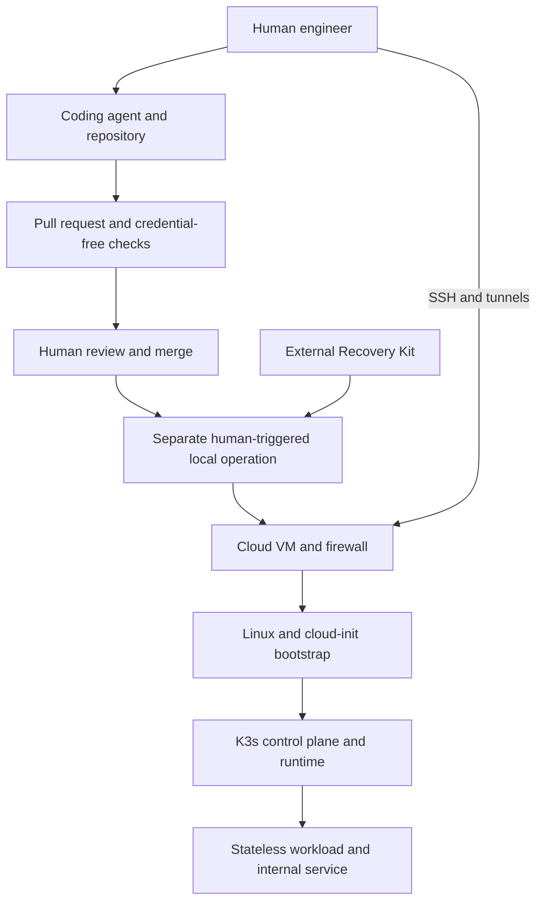

# Initial architecture

Status: consolidated discovery design accepted by the engineer on 2026-10-18, including the recovery-service arrangement. Implementation and provisioning remain unauthorized. No cloud resources or application code have been created.

## Boundaries

The Software Factory stays outside the disposable Platform Lab. It consists initially of the human engineer, an established coding agent, the repository, and pull-request checks. It produces reviewable changes and evidence.

The Delivery System consists of credential-free GitHub Actions validation plus human-triggered local OpenTofu operations, cloud-init bootstrap, and Kubernetes workload application. There is no initial automatic deployment on merge.

The Platform Lab is one Linux VM running K3s as both control plane and workload node. K3s manages application containers through its bundled runtime. Losing the VM loses the cluster and its workload data; the repository and Recovery Kit are the source of recreation.

## Confirmed starting choices

| Concern | Initial choice | Boundary |
| --- | --- | --- |
| Infrastructure | One self-managed cloud VM | No managed Kubernetes or availability promise |
| Provider | Hetzner preferred conditionally | Price, region, capacity and alternative providers remain a preflight decision |
| Provisioning | OpenTofu | Cloud resources and infrastructure state |
| Bootstrap | cloud-init | Initial host setup; creation is distinct from successful bootstrap |
| Kubernetes | K3s | Understand its packaged components; defer kubeadm comparison |
| Configuration management | No Ansible initially | Introduce only for a demonstrated need |
| Administration | Key-authenticated SSH, commands on node, tunnels as needed | No public Kubernetes API or public workload endpoint |
| Workload | Tiny, reviewed stateless HTTP workload | No database, domain, or custom application feature work |
| State | Encrypted local OpenTofu state with external recoverable backup | No remote backend initially |
| CI | Standard GitHub-hosted pull-request checks without live credentials | Authenticated plans and deployment verification remain local |

The workload serves as a test instrument: it must expose health, service reachability, and a diagnosable failure. Its exact image is an implementation choice, pinned to a specific version or digest rather than a moving `latest` tag.

Retain K3s defaults needed for core operation; omit unnecessary public ingress/load-balancer exposure. A cloud firewall must explicitly restrict inbound administration to the engineer's permitted source and block public API/workload access. Exact listener and firewall configuration must be verified during implementation; SSH use alone is not proof of restricted exposure.

## Authority and credentials

Agents receive no live cloud or cluster credentials for this milestone. The engineer performs authenticated operations separately after reviewing the target and intended effect. Infrastructure state (including encrypted state), credentials, keys, recovery archives, and kubeconfigs must never be published into the public repository or CI artifacts. Plans and logs containing sensitive material must also remain private; only sanitized evidence summaries may be published.

This is initially a supervised workflow, not a claim of hostile-code isolation. An agent on the same workstation may have access to ambient files or unlocked services. Before credentialed operations, the engineer must establish that the agent process cannot inspect the supplied credentials during execution, for example by ending its execution session and retaining credentials only in the separate human-run process. A vault reference is not itself an authorization boundary. Hardened agent execution is a later experiment.

## Accepted recovery arrangement

Store the OpenTofu state-encryption passphrase in 1Password. Store dated encrypted state backups in OneDrive. Keep keys outside those backup files. The engineer accepted this arrangement on 2026-10-18; the recovery test remains a pre-provisioning prerequisite.

Sync is a transport, not the whole backup strategy: preserve independent dated copies, verify upload completion, and test decrypting a restored copy. Retention and version history supplement those copies. State and saved-plan encryption are distinct settings; preferably do not retain saved plans unless required, and encrypt any retained sensitive plans.

The Recovery Kit inventory covers provider account access, the restricted API credential or its reissue procedure, SSH access material or replacement procedure, encrypted state and its decryption key, relevant tool/version prerequisites, and the inventory of billable resources. Never restore old state blindly over current state: reconcile actual resources before making changes.

The first recovery test covers complete VM loss, not loss of all personal accounts or the workstation. A copied state artifact must still be recoverable from the chosen backup destination with the separately stored key before provisioning is authorized. The planned teardown/recreation demonstration uses a separately downloaded post-destroy state backup, reconciled against provider inventory before a fresh plan is reviewed. The runbook must also document reconciliation after unplanned VM loss or restoration of stale state; a separate injected unplanned-loss exercise is deferred.

## Lifecycle and cost

Default to destruction at session end, including allocated IPs, disks, snapshots, and any other billable supporting resources. An explicit within-budget exception may preserve an unfinished experiment. Powering off a VM must not be treated as proof of stopped billing.

Before provisioning, record the selected plan and region, current price and availability, tax and SGD conversion, all supporting-resource charges, and expected usage across the month. The sum must fit S$30. Maintain headroom; alerts do not enforce a hard provider spending cap. No custom cost controller is required initially.

## Failure and verification boundaries

Check cloud resource creation, bootstrap completion, node health, workload health, and service reachability independently. If bootstrap fails, inspect its status and logs before replacement. A replacement or destruction remains a separate human-authorized operation.

VM deletion is not workload data recovery. Infrastructure state is not Kubernetes cluster state. A clean OpenTofu plan is not proof of workload health. A reachable service is not proof that access restrictions are correct. Each assertion requires its own evidence.

The [accepted first-milestone issue](https://github.com/cgono/ai-platform/issues/1) defines the acceptance gates. Approval authorizes implementation planning only. Later GitOps reconciliation or autonomous execution must explicitly revisit the approval boundary in ADR 0002.
